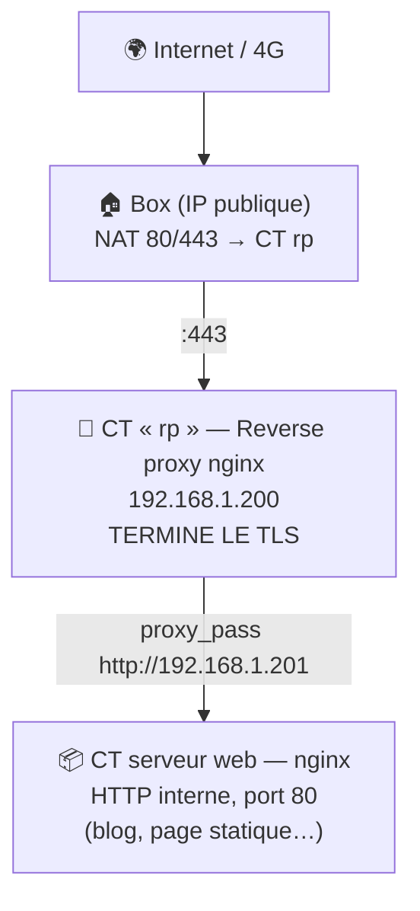

# 🔄 PROCÉDURE — Reverse proxy nginx : TLS, proxy_pass, recâblage

> **Repo** : `admin-procedures/hebergement/PROCEDURE-reverse-proxy.md`
> **Auteur** : Basile Malin · **Date** : 03/11/2026 · **Statut** : ✅ validé en production (basile-malin.fr, geomonkey.fr)
> **Usage** : parcourir avec `Ctrl+F` grâce à l'**INDEX DES MOTS-CLÉS** ci-dessous.

---

## 🧭 INDEX DES MOTS-CLÉS (Ctrl+F)

| Mot-clé | Section |
|---|---|
| `ARCHITECTURE` | Rôle du reverse proxy dans l'infra |
| `PRINCIPE` | Les 4 règles d'or |
| `AJOUTER-DOMAINE` | Ajouter un nouveau site derrière le proxy |
| `PROXY-PASS` | Recâbler un proxy_pass (migration) |
| `CERTIFICATS` | Let's Encrypt, certbot, renouvellement |
| `NGINX-T` | Voir toute la configuration chargée |
| `TROUBLESHOOTING` | Pièges et symptômes |
| `CHECKLIST` | Vérifications finales |

---

## 🗺️ ARCHITECTURE — Rôle du reverse proxy dans l'infra



**Un seul point d'entrée HTTPS** : le proxy reçoit tout le trafic chiffré, et parle en HTTP clair (interne, réseau privé) aux serveurs derrière lui. Les certificats ne vivent QUE là.

---

## 📐 PRINCIPE — Les 4 règles d'or

1. **Le TLS s'arrête au proxy.** Derrière, c'est du HTTP interne — jamais de double TLS inutile (`https://IP-privée` compliqué à certifier, sans bénéfice).
2. **Un domaine = un bloc `server`.** `server_name` en entrée, un seul `proxy_pass` en sortie.
3. **`nginx -t` AVANT chaque reload.** Une faute de frappe ne doit jamais couper tous les sites d'un coup.
4. **Le proxy ne sait rien du contenu.** Il transporte. Le contenu vit dans les dossiers du serveur interne.

---

## ➕ AJOUTER-DOMAINE — Mettre un nouveau site derrière le proxy

### 1. Dans le CT serveur web (ex. CT 201)

```nginx
# /etc/nginx/sites-available/mon-site
server {
    listen 80;
    server_name mon-site.fr www.mon-site.fr;
    root /var/www/mon-site;
    index index.html;
    location / { try_files $uri $uri/ =404; }
    location ~ /\. { deny all; }
    server_tokens off;
}
```
```bash
ln -sf /etc/nginx/sites-available/mon-site /etc/nginx/sites-enabled/
nginx -t && systemctl reload nginx
```

### 2. Dans le CT proxy (rp)

```nginx
# /etc/nginx/sites-available/mon-site.fr
server {
    server_name mon-site.fr www.mon-site.fr;
    location / {
        proxy_pass http://192.168.1.201;   # IP du serveur interne
    }
}
```

### 3. Certificat (certbot dans le proxy uniquement)

```bash
sudo certbot --nginx -d mon-site.fr -d www.mon-site.fr
```
→ certbot crée le 443, les redirections 80→443, et programme le renouvellement.

### 4. DNS + NAT

- Zone OVH : domaine → IP publique de la box (incrémenter le serial !)
- Box : NAT 443 → IP du proxy (déjà en place si les autres sites marchent)

---

## 🔌 PROXY-PASS — Recâbler un proxy_pass (après une migration)

**Cas d'école** : le serveur interne a changé d'IP (VM 192.168.1.18 → CT 192.168.1.201).

```bash
# 1. Trouver TOUS les fichiers qui référencent l'ancienne IP
pct exec 200 -- grep -rln "192.168.1.18" /etc/nginx/

# 2. Remplacer (exemple geomonkey.fr)
pct exec 200 -- sed -i 's#https://192.168.1.18#http://192.168.1.201#' /etc/nginx/sites-available/geomonkey.fr
# ⚠️ Profiter du recâblage pour SIMPLIFIER : https → http interne (règle n°1)

# 3. Vérifier, tester, recharger
pct exec 200 -- grep -n "proxy_pass" /etc/nginx/sites-available/geomonkey.fr
pct exec 200 -- bash -c "nginx -t && systemctl reload nginx"
```

---

## 🔐 CERTIFICATS — Let's Encrypt / certbot

- Emplacement : `/etc/letsencrypt/live/<domaine>/` (fullchain.pem + privkey.pem) — **dans le proxy uniquement**
- Renouvellement : timer systemd certbot (`systemctl list-timers | grep certbot`)
- Vérifier les renouvellements à venir : `sudo certbot certificates`
- Après une migration de serveur interne, **aucun changement de certificat** : le domaine et le proxy n'ont pas bougé.

---

## 🔎 NGINX-T — Voir toute la configuration chargée

**Le réflexe n°1** quand un comportement est incompréhensible :

```bash
nginx -T | grep -En "server_name|proxy_pass|ssl_certificate|listen"
```

- `nginx -T` affiche **toute** la conf réellement chargée, où qu'elle vive (`sites-enabled/`, `conf.d/`, includes…)
- **Piège** : `sites-enabled/` peut sembler vide alors que la conf charge — elle vit ailleurs. `nginx -T` ne ment jamais.

---

## 🚨 TROUBLESHOOTING — Pièges et symptômes

| Symptôme | Cause probable | Réparation |
|---|---|---|
| `Connection refused` vers un serveur interne | fail2ban a banni l'IP appelante | `sudo fail2ban-client set sshd unbanip <IP>` |
| Le site sert le **mauvais contenu** | Le Host ne matche aucun `server_name` → nginx prend le server par défaut | Vérifier `server_name` avec `nginx -T`, et le `proxy_set_header Host` si le serveur interne virtualise |
| `502 Bad Gateway` | Le serveur derrière le proxy est down, ou mauvaise IP dans `proxy_pass` | `curl -H "Host: ..." http://IP_INTERNE` depuis le proxy |
| Modif invisible après reload | `systemctl reload` pas exécuté, ou édité le mauvais fichier (`.conf` vs `sites-available/`) | `nginx -T` pour voir ce qui charge réellement |
| grep qui ne trouve rien | Syntaxe : `grep "a\|b"` littéral sans `-E` | Toujours `grep -E` ou `grep -rEn` |
| `failed to create file: /tmp/: Is a directory` | `pct push` exige un chemin de **fichier** complet | `pct push 201 fichier /tmp/fichier` |

---

## ✅ CHECKLIST — Après toute modif du proxy

- [ ] `nginx -t` → `syntax is ok`
- [ ] `systemctl reload nginx` exécuté
- [ ] Test **interne** : `curl -s -H "Host: domaine" http://IP_INTERNE | head -5`
- [ ] Test **externe en 4G** : site + cadenas vert
- [ ] Test de **non-régression** : les autres sites du proxy répondent toujours
- [ ] `grep -rn "ANCIENNE_IP" /etc/nginx/` ne renvoie plus rien

---

## 🔗 Procédures liées

- `proxmox/PROCEDURE-migration-vm-vers-ct.md` — le cas d'école complet (migration + recâblage)
- À venir si besoin : `PROCEDURE-dns-ovh.md` (zone, DynHost, serial)

---

*Dernière mise à jour : 03/11/2026 — procédure extraite de la migration VM 101 → CT 201.*
