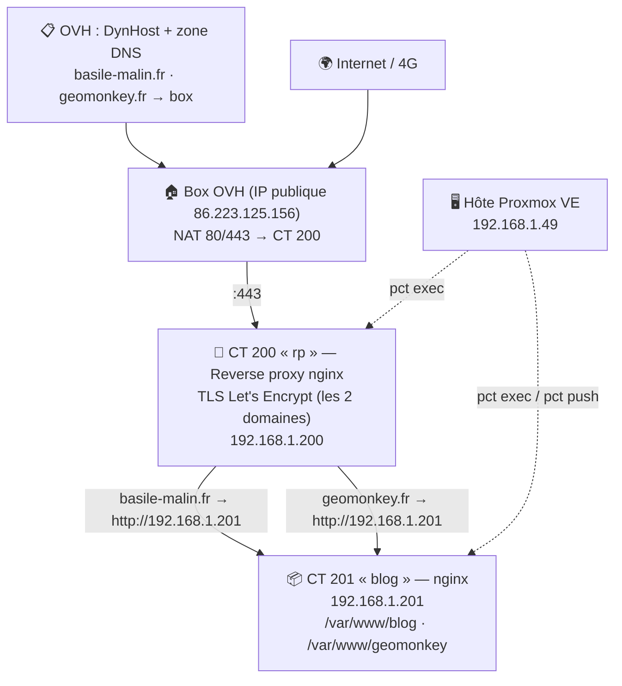

# 🖥️ Infrastructure auto-hébergée — Carte réseau & migration VM 101 → CT 201

> **Auteur** : Basile Malin · **Date** : 03/11/2026 · **Statut** : ✅ migration terminée, VM 101 détruite
> **Usage** : parcourir avec `Ctrl+F` grâce à l'**INDEX DES MOTS-CLÉS** ci-dessous.

---

## 🧭 INDEX DES MOTS-CLÉS (Ctrl+F)

| Mot-clé | Section |
|---|---|
| `ARCHITECTURE` | La carte réseau complète |
| `DNS` | OVH, DynHost, zone, enregistrement |
| `NAT` | Redirections de ports de la box |
| `REVERSE-PROXY` | CT 200, TLS, proxy_pass, certificats |
| `CERTBOT` | Let's Encrypt, renouvellement |
| `MIGRATION` | Procédure complète VM → CT |
| `FAIL2BAN` | IP bannie, unbanip, connection refused |
| `SSH` | Connexion refusée, root désactivé |
| `PCT` | pct push, pct exec, pct enter, pièges |
| `QM` | qm shutdown, qm destroy, protection |
| `TAR` | Archiver, transférer, extraire |
| `TROUBLESHOOTING` | Tous les pièges rencontrés |
| `NGINX` | Vhost, sites-available, nginx -T |
| `SEO` | Indexation Google, Search Console |
| `CHECKLIST` | Checklists de vérification |

---

## 🗺️ ARCHITECTURE — La carte réseau complète

### Vue d'ensemble (03/11/2026, après migration)



### Les machines

| Machine | IP | Rôle | État |
|---|---|---|---|
| Hôte Proxmox VE | 192.168.1.49 | Hyperviseur, `qm` / `pct` | ✅ actif |
| CT 200 « rp » | 192.168.1.200 | Reverse proxy nginx + TLS | ✅ actif |
| CT 201 « blog » | 192.168.1.201 | Serveur web statique (blog + page geomonkey) | ✅ actif |
| VM 101 « geomonkey » | 192.168.1.18 | Ancien serveur web (legacy) | 🗑️ **détruite 03/11/2026** |

### Règles d'or de l'architecture

- **Un seul point d'entrée** : tout le trafic public passe par le CT 200 (reverse proxy), qui fait le HTTPS.
- **Derrière le proxy, tout est en HTTP interne** (pas de double TLS inutile).
- **Chaque site = un dossier** dans le CT 201 + un `server_name` dans son vhost.

---

## 📋 DNS — OVH, DynHost, zone

- **Principe** : les domaines `basile-malin.fr` et `geomonkey.fr` (OVH) pointent vers l'IP **publique de la box** (86.223.125.156, mise à jour par DynHost si IP dynamique).
- La box fait le **NAT** 80/443 vers le CT 200. Aucun service interne n'est exposé directement.
- **Modifier la zone OVH** : Éditeur de zone → ajouter/modifier l'enregistrement → **incrémenter le serial** (YYYYMMDDnn) → appliquer. Propagation : quelques minutes à 24 h.
- ⚠️ Le DNS ne pointe **jamais** vers une IP privée (192.168.x.x) — toujours vers l'IP publique de la box.

## 🔀 NAT — Redirections de ports de la box

- 80/443 (externe) → `192.168.1.200` (CT rp).
- Après toute migration, **vérifier qu'aucune règle NAT ne pointe vers une IP retirée** (ex. 192.168.1.18).

## 🔄 REVERSE-PROXY — CT 200 (rp)

- nginx termine le TLS avec les certificats Let's Encrypt de **chaque domaine** (`/etc/letsencrypt/live/basile-malin.fr/`, `/etc/letsencrypt/live/geomonkey.fr/`).
- Chaque domaine a son vhost : `server_name` + `proxy_pass` vers le serveur interne :
  - `basile-malin.fr` → `proxy_pass http://192.168.1.201;`
  - `geomonkey.fr` → `proxy_pass http://192.168.1.201;`
- **Commandes utiles** :
  - `nginx -T | grep -En "server_name|proxy_pass|ssl_certificate|listen"` → voir TOUTE la conf chargée
  - `nginx -t && systemctl reload nginx` → tester puis recharger (toujours dans cet ordre)

## 🔐 CERTBOT — Let's Encrypt

- Les certificats vivent dans le **CT 200** (le seul qui parle TLS). Certbot y tourne pour les renouvellements.
- Après migration, les certificats de l'ancienne VM sont devenus inutiles — aucune action.

---

## 🚚 MIGRATION — Procédure complète VM → CT (le cas d'école)

> Contexte : migrer la page statique `geomonkey.fr` de la VM 101 vers le CT 201, puis détruire la VM.

### Étape 0 — Cartographier AVANT de toucher

```bash
# Sur la machine source : qui sert quoi ?
ls -la /var/www/
ls -la /etc/nginx/sites-enabled/ /etc/nginx/conf.d/
nginx -T | grep -En "server_name|proxy_pass|ssl_certificate|listen"

# Sur le proxy : où va le trafic ?
pct exec 200 -- grep -rln "192.168.1.18" /etc/nginx/
```

### Étape 1 — Archiver (dans la VM source)

```bash
sudo tar czf /tmp/geo-static.tar.gz -C /var/www geomonkey
sudo chown bazmati:bazmati /tmp/geo-static.tar.gz   # ⚠️ chown pour que scp puisse lire
```

### Étape 2 — Transférer vers le CT (sur l'hôte PVE)

```bash
scp bazmati@192.168.1.18:/tmp/geo-static.tar.gz /tmp/          # ⚠️ PAS root (SSH root désactivé)
pct push 201 /tmp/geo-static.tar.gz /tmp/geo-static.tar.gz     # ⚠️ chemin FICHIER complet, pas /tmp/
pct exec 201 -- bash -c "tar xzf /tmp/geo-static.tar.gz -C /var/www/ && ls -la /var/www/geomonkey/"
```

### Étape 3 — Vhost dans le CT (port 80, le proxy fait le TLS)

```bash
pct enter 201
cat > /etc/nginx/sites-available/geomonkey <<'EOF'
server {
    listen 80;
    server_name geomonkey.fr www.geomonkey.fr;
    root /var/www/geomonkey;
    index index.html;
    location / { try_files $uri $uri/ =404; }
    location ~ /\. { deny all; }
    server_tokens off;
}
EOF
ln -sf /etc/nginx/sites-available/geomonkey /etc/nginx/sites-enabled/
nginx -t && systemctl reload nginx
```

### Étape 4 — Recâbler le proxy (CT 200)

```bash
pct exec 200 -- grep -rln "192.168.1.18" /etc/nginx/            # trouver le fichier
pct exec 200 -- sed -i 's#https://192.168.1.18#http://192.168.1.201#' /etc/nginx/sites-available/geomonkey.fr
pct exec 200 -- bash -c "nginx -t && systemctl reload nginx"
```

### Étape 5 — Vérifier puis démanteler

```bash
# Test interne
curl -s -H "Host: geomonkey.fr" http://192.168.1.201 | head -5

# Test externe : EN 4G (téléphone hors wifi) — le seul qui compte
#   https://geomonkey.fr ✅  https://basile-malin.fr ✅ (non-régression)

# Puis
qm shutdown 101
qm set 101 --protection 0     # si mode protection
qm destroy 101 --purge
```

---

## 🚨 TROUBLESHOOTING — Tous les pièges rencontrés (03/11/2026)

### FAIL2BAN — « Connection refused » après des échecs SSH

- **Symptôme** : `scp` échoue avec `Connection refused` alors que sshd tourne et écoute.
- **Cause** : 3 échecs de mot de passe (ex. root) → fail2ban **ban l'IP source** (REJECT).
- **Diagnostic** :
```bash
sudo fail2ban-client status sshd        # voir les IP bannies
```
- **Réparation** :
```bash
sudo fail2ban-client set sshd unbanip 192.168.1.49
# Liste blanche temporaire pendant une migration :
sudo fail2ban-client set sshd addignoreip 192.168.1.49
```
- **Leçon** : « refused » ≠ service down. Vérifier `ss -tlnp` AVANT de conclure.

### SSH — root désactivé par design

- **Symptôme** : `scp root@...` → `Permission denied (publickey,password)` avec le bon mot de passe.
- **Cause** : `PermitRootLogin` désactivé dans sshd_config.
- **Réparation** : passer par l'utilisateur sudoer (`bazmati`), avec `sudo` sur la machine source et `chown` sur l'archive.

### PCT — pièges des commandes

- `pct push 201 fichier /tmp/` → **erreur** `failed to create file: Is a directory`. Il faut un **chemin de fichier complet** : `pct push 201 fichier /tmp/fichier`.
- `pct exec 201 -- curl ...` → curl absent dans le CT. Tester depuis l'hôte : `curl -H "Host: ..." http://IP_DU_CT`.
- `pct enter 201` = shell interactif dans le CT (pratique pour écrire des fichiers).

### GREP — syntaxe

- `grep "a|b"` ne cherche PAS « a ou b » : sans `-E`, le `|` est littéral. Toujours `grep -E` ou `grep -rEn`.

### QM — suppression d'une VM

- `qm destroy` échoue si **protection mode** : `qm set 101 --protection 0` d'abord.
- Toujours `qm shutdown` avant `qm destroy`.
- (Prudence conseillée : attendre ~1 semaine entre shutdown et destroy pour détecter les références oubliées.)

### NGINX — où vit la conf ?

- `sites-enabled/` peut être vide alors que la conf charge : elle vit dans `sites-available/` inclus directement, ou `conf.d/`. **`nginx -T` affiche toujours toute la vérité.**

---

## ✅ CHECKLIST — Vérifications après une migration

- [ ] `nginx -t` OK sur le CT ET sur le proxy
- [ ] Test **interne** : `curl -s -H "Host: domaine" http://IP_CT | head -5`
- [ ] Test **externe en 4G** : site + cadenas
- [ ] Test de **non-régression** : les autres sites hébergés répondent toujours
- [ ] Aucune règle NAT de la box ne pointe vers l'ancienne IP
- [ ] `grep -rn "ANCIENNE_IP" /etc/nginx/` vide sur proxy et CT
- [ ] Plus aucun fichier `.bak` / backup public dans la racine web
- [ ] Uniquement alors : éteindre (shutdown), puis détruire (destroy)

---

## 🔍 SEO — Rendre le blog visible sur Google (03/11/2026)

- **État vérifié** : robots.txt OK, sitemap déclaré, aucun `noindex` → le site est prêt, il manque juste les liens entrants + la déclaration.
- **À faire** :
  1. **Google Search Console** : ajouter la propriété → vérification TXT dans la zone OVH (incrémenter le serial !) → soumettre `sitemap.xml`
  2. **Bing Webmaster Tools** : import possible depuis la config Google (nourrit aussi Brave)
  3. **Backlinks GitHub** : profil `Bazmati`, README du repo CV, README geomonkey → tous pointer vers `https://basile-malin.fr`
  4. **Maillage avec `rel="me"`** sur les pages statiques (le blog, la page geomonkey) pour lier l'identité
- **Détail technique** : choisir un canonique unique (`basile-malin.fr`) et rediriger le www en 301 dans le vhost.

---

## 📚 Pour aller plus loin

- **Refaire le cas d'école** : restaurer la VM depuis le backup Proxmox (`qmrestore`) si besoin de réviser.
- Repo `admin-procedures` : y copier ce document comme procédure officielle `migration-vm-vers-ct.md`.
- Blog : écrire l'article « Comment j'ai migré mon serveur web en 10 commandes » — matière première toute chaude 😄

---

*Dernière mise à jour : 03/11/2026 — migration validée par tests 4G, VM 101 détruite.*
